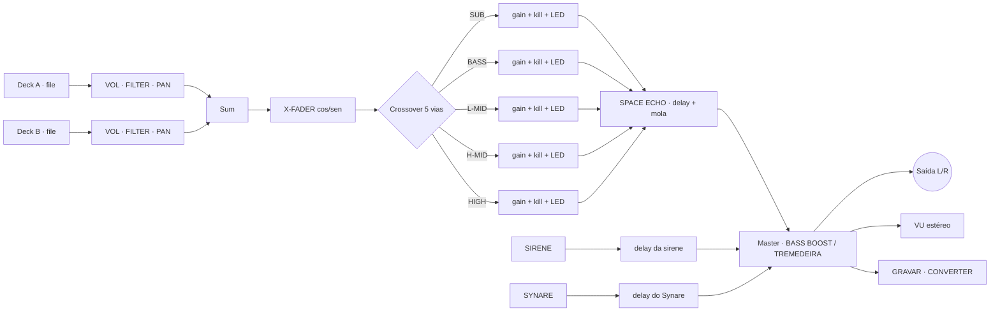
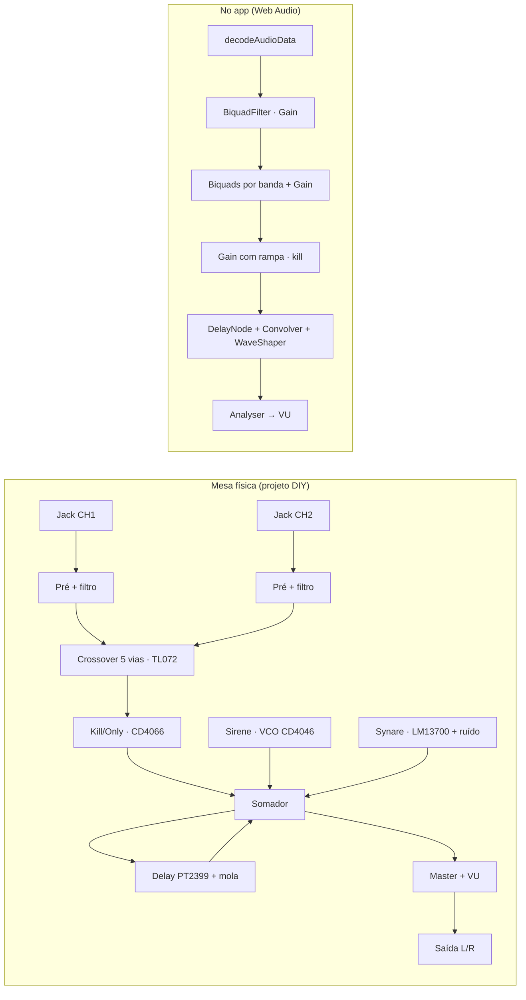

# DUB MIXER Sound System

**Mesa de dub completa — crossover de 5 vias, delay de fita estilo RE-201, sirene e Synare — dentro de um único arquivo HTML.** Roda em qualquer navegador moderno, toca os seus arquivos locais e não acessa a internet.

[](LICENSE)
[](index.html)
[](#como-funciona)
[](https://developer.mozilla.org/pt-BR/docs/Web/API/Web_Audio_API)


## O que é

Um simulador de mesa de dub em `index.html`, sem instalação, sem conta e sem build:

- **Crossover de 5 vias** com fader, kill e LED por banda, mais ONLY SUB / BASS+SUB KILL / ONLY MID-HIGH / ONLY HIGH.
- **SPACE ECHO (Roland RE-201)** — delay de fita separado, com 12 modos de tempo, TAP TEMPO, DRY, reverb de mola e EQ do eco.
- **SIRENE** com 10 presets de sound system e **SYNARE (Space Drum)** com 10 presets — cada um com delay exclusivo.
- **X-FADER** com lei de ganho constante, **VU estéreo** (L/R) e **BASS BOOST**.
- **💥 TREMEDEIRA** — corpo extra de graves + saturação + o ar do sistema, com o gabinete tremendo junto.
- **GRAVAR MIX** (`.webm`/`.ogg`/`.m4a`) e **CONVERTER** (WAV 16-bit/44,1 kHz com todos os ajustes).
- **MIDI** com soft takeover, 16 temas, modo edição, PWA offline.

## Como usar

| Modo | Como |
|---|---|
| **Arquivo local** | Baixe o ZIP → abra `index.html` (duplo clique). Funciona offline. |
| **Servidor local** | `python3 -m http.server 8712` ou `./dub-mixer.sh` (Linux/macOS) |
| **Celular na Wi-Fi** | Abra `http://<ip-do-pc>:8712` (o `dub-mixer.sh` mostra o endereço) |
| **Online (GitHub Pages)** | https://hroderik.github.io/dub-sound-system-studio/ |
| **PWA** | Instale pela barra do navegador — abre offline |
| **Executável nativo** | Veja [Versão executável](#versão-executável-rust--tauri-2) (Linux / Windows) |

> Se a tela aparecer estranha depois de uma atualização: `Ctrl+Shift+R`.


## Funções

### Mixer e decks (2 canais)

| Controle | O que faz |
|---|---|
| **▶ PLAY / ⏸ STOP** | Toca/pausa o arquivo local do canal |
| **📀 TIRAR AGULHA** | Para com o estalo da agulha — o pop e a música ecoam a 40 % no SPACE ECHO |
| **🔄 DISCO REVERSO** | Backspin de 1,2× com som de disco arranhando |
| **VOL / PAN / FILTER** | Volume, pan e filtro bipolar (centro = aberto; esquerda fecha o lowpass, direita sobe o highpass) |
| **LED + VU + barra** | Nível do canal e posição da faixa |

### Crossover de 5 vias

| Banda | Faixa | Banda | Faixa |
|---|---|---|---|
| SUB | < 80 Hz | H-MID | 1,2 – 5 kHz |
| BASS | 80 – 250 Hz | HIGH | > 5 kHz |
| L-MID | 250 Hz – 1,2 kHz | | |

Cada banda tem volume (0–200 %), kill na hora e LED. Os botões de banda fazem:
**ONLY SUB** · **BASS+SUB KILL** · **ONLY MID-HIGH** · **ONLY HIGH** · **BASS BOOST** (+12 dB < 110 Hz) · **💥 TREMEDEIRA**.

### SPACE ECHO (RE-201)

EFFECT e DIRECT (com LED), INPUT VOL, MODE SELECTOR (12 tempos: 1×, ½×, ¾×, ⅔×, 1¼×, 1½×, 2×, 2½×, ⅓×, 3×, 4×, ¼×), BASS/TREBLE do eco (±12 dB), REVERB de mola, INTENSITY (0–90 %), ECHO VOLUME, REPEAT RATE (0,05–1,20 s), DRY e **TAP TEMPO**.

### Sirene e Synare


**SIRENE** — 10 presets (O.B.F, Iration, Tubby, Shaka...), PITCH 50–1500 Hz, RATE 0,01–25 Hz, VOL 40 %, delay exclusivo, botões **SIRENE** e **SWEEP** (desacelera o rate até o mínimo).


**SYNARE** — 10 presets de syn drum que ajustam TUNE/SWEEP/DECAY/TONE/NOISE/SPACE e o delay de uma vez (o **VOL**, que abre em **70 %**, fica como você deixar), delay exclusivo e pad de trigger.

### Master, VU e utilitários


- **X-FADER** (duplo clique volta ao centro) e **VU estéreo L/R** (LED + ponteiro analógico, dependendo do tema).
- **GRAVAR MIX** e **CONVERTER** para levar o dub pra fora.
- **🎹 MIDI** (CC mapeado, soft takeover) e **☀️/🌙** (fundo claro/noturno num botão só).
- **Barra de pedais**: SIRENE (visível por padrão) e SYNARE (oculto por padrão) ligam/desligam. Ocultar encurta a mesa.


### Os 36 knobs

Todos: **arraste para cima/baixo** (mouse ou dedo), **duplo clique** volta ao padrão.

| Deck (×2) | Faixa | Padrão | | Crossover | Faixa | Padrão |
|---|---|---|---|---|---|---|
| VOL | 0–100 % | 100 % | | SUB / BASS / L-MID / H-MID / HIGH | 0–200 % | 100 % |
| FILTER | LP ↔ HP | centro | | | | |
| PAN | L ↔ R | centro | | | | |

| SPACE ECHO | Faixa | Padrão | | Sirene | Faixa | Padrão |
|---|---|---|---|---|---|---|
| REPEAT RATE | 0,05–1,20 s | 0,375 s | | PITCH | 50–1500 Hz | 440 Hz |
| INTENSITY | 0–90 % | 40 % | | RATE | 0,01–25 Hz | 3 Hz |
| ECHO VOLUME | 0–100 % | 0 % | | VOL | 0–100 % | 40 % |
| DRY | 0–100 % | 100 % | | TIME/FB/WET (delay) | — | 0,375 s / 40 % / 30 % |
| REVERB | 0–100 % | 0 % | | **Synare** | | |
| INPUT VOL | 0–150 % | 100 % | | TUNE | 40–1000 Hz | 220 Hz |
| MODE | 1–12 | 1 | | SWEEP | 0–100 % | 80 % |
| BASS / TREBLE | ±12 dB | 0 dB | | DECAY | 0,05–1,5 s | 0,45 s |
| | | | | TONE | 100–6000 Hz | 900 Hz |
| | | | | NOISE / SPACE | 0–100 % | 35 % / 20 % |
| | | | | VOL | 0–100 % | **70 %** |
| | | | | TIME/FB/WET (delay) | — | 0,3 s / 45 % / 35 % |

### Temas (16)

Trocados na barra de ferramentas — mudam material, cor dos knobs, LEDs e texto, mantendo o layout.

| | | | |
|---|---|---|---|
| 1. Dub Preamp Original | 2. Mustard Synth | 3. Benidub Style | 4. DIY Box |
| 5. Golden Acapulco | 6. DJ Mixer | 7. Vintage Conservado | 8. MPC Clássica |
| 9. Rastafari | 10. King Tubby's Water | 11. Volcano Lava | 12. Cosmic Dub |
| 13. Neve 1073 | 14. API 512 | 15. SSL 4000 | 16. Tube Preamp |


## Como funciona

O grafo de áudio é montado **uma única vez** quando o áudio é liberado; os knobs só alteram parâmetros (com rampas de ~50 ms, sem estalo). Sirene e Synare são vozes *one-shot* que se desconectam sozinhas ao fim do envelope — pode martelar o trigger que não acumula. Tudo em um arquivo: sem framework, sem build, sem dependência.



## Da eletrônica ao software

A mesa foi desenhada como **equipamento**: cada bloco segue um circuito clássico — e vira o nó equivalente no Web Audio. É este o mapa entre o roadmap de hardware e o app:



| Bloco no equipamento | No app |
|---|---|
| Filtros por canal / crossover (Sallen-Key, TL072) | `BiquadFilterNode` (lowpass/highpass) + `GainNode` por banda |
| Kill / only (chave analógica CD4066) | `GainNode` indo a zero com rampa de ~50 ms |
| Delay de fita (RE-201) | `DelayNode` + feedback + lowpass + `ConvolverNode` (mola) |
| Sirene (VCO CD4046 + LFO) | `OscillatorNode` + LFO modulando a frequência |
| Synare (oscilador + ruído + VCA LM13700) | `OscillatorNode` + buffer de ruído + envelope de ganho |
| VU (LM3915 / ponteiro) | `AnalyserNode` + `requestAnimationFrame` |
| X-FADER (pot duplo cos/sen) | dois `GainNode` com curvas cos/sen |
| BASS BOOST / TREMEDEIRA | `BiquadFilterNode` lowshelf + `WaveShaper` (saturação) + limiter |
| Gravação / exportação | `MediaRecorder` e `OfflineAudioContext` → WAV |

> Os kernels DSP também existem em Rust (`rust/src/dsp.rs`) para a versão nativa — mesma matemática, outro runtime.

## Estrutura do projeto

```
dub-sound-system-studio/
├── index.html                  ← O APP INTEIRO (HTML+CSS+JS, fonte e favicon embutidos)
├── icon-192.png / icon-512.png ← ícones do PWA
├── manifest.json + sw.js       ← PWA (instalável, offline)
├── shots.mjs + package.json    ← gerador dos prints do README (dev)
│
├── frontend/                   ← assets web para o executável (index.html, sw.js, ícones)
├── dsp/                        ← kernels DSP de referência (C + JS)
├── rust/                       ← executável nativo (Tauri 2): src/, icons/, tauri.conf.json
├── dub-mixer.sh                ← launcher Linux/macOS
├── Dub Mixer.command           ← launcher macOS (duplo clique)
│
└── docs/
    ├── ROADMAP-HARDWARE.md     ← plano da versão física (DIY)
    └── img/                    ← prints e ícone (icon.svg)
```

## Versão executável (Rust + Tauri 2)

A pasta `rust/` empacota a mesma interface num app de janela (sem navegador). Os 6 kernels de DSP (`dsp.rs`) ficam prontos para os próximos racks.

```bash
cd rust
cargo tauri build     # Linux: .deb, .rpm e AppImage · Windows: .exe (NSIS) e .msi · macOS: .dmg
```

| Plataforma | Artefatos | Observação |
|---|---|---|
| Linux | `.deb` · `.rpm` · `.AppImage` | testado e gerado neste repo |
| Windows | `.exe` (NSIS) · `.msi` | requer toolchain MSVC |
| macOS | `.dmg` · `.app` | requer um Mac — há workflow de CI pronto em `.github/workflows/` |

## Verificação dos instaladores

Cada release publica `SHA256SUMS.txt` e `MD5SUMS.txt` com os hashes de todos os artefatos. Depois de baixar, confira:

```bash
# Linux
sha256sum -c SHA256SUMS.txt --ignore-missing
md5sum -c MD5SUMS.txt --ignore-missing
```

```bash
# macOS
shasum -a 256 -c SHA256SUMS.txt
md5 -r *.dmg   # confira com o MD5SUMS.txt
```

```powershell
# Windows (PowerShell)
Get-FileHash .\setup.exe -Algorithm SHA256
Get-FileHash .\setup.exe -Algorithm MD5
```

O hash calculado tem que bater com a linha do arquivo nos `*SUMS.txt`. Se não bater, não instale: baixe de novo da página oficial de releases.

## Segurança e privacidade

- **100 % offline** — a fonte e o ícone estão embutidos no arquivo; o app não faz *nenhum* request externo, não tem telemetria e toca apenas arquivos que você escolhe.
- **CSP** no HTML e no app nativo — bloqueia script e conteúdo de terceiros.
- **Validação dos arquivos** carregados (formato de áudio e limite de tamanho) e **drag & drop desativado** — soltar um arquivo na janela não navega pra fora do app.
- **Service worker restrito** a GET do mesmo domínio (nada de interceptar outros domínios).
- **Kernel Rust com limites** de buffer e de parâmetros — nunca confia no que vem da interface.
- Sem `innerHTML`: nada de HTML injetado por dados.

## Compatibilidade

| Navegador / dispositivo | Resultado |
|---|---|
| Firefox (desktop, 320–1440 px) | ✅ testado |
| Chrome / Chromium / Edge | ✅ testado (inclui os prints do README, via Playwright) |
| Android / iPhone (toque) | ✅ testado |
| Safari (macOS / iOS) | ⏳ ainda não testado — é o único motor em aberto |

## Roadmap

### Concluído

- [x] **GRAVAR MIX** + **CONVERTER** (WAV 16-bit/44,1 kHz)
- [x] **BASS BOOST** (+12 dB < 110 Hz) e **💥 TREMEDEIRA**
- [x] **Delay sincronizado** — TAP TEMPO + MODE SELECTOR de 12 divisões
- [x] **Reverb de mola** no caminho do eco
- [x] **MIDI com soft takeover**
- [x] **PWA** — instalável e offline (manifest + service worker + ícone próprio)
- [x] **Orientação paisagem** travada pelo manifest
- [x] **SPACE ECHO (RE-201)**, TIRAR AGULHA com eco a 40 %, DISCO REVERSO, VU estéreo, X-FADER
- [x] **16 temas** com contraste revisado + modo edição + toolbar auto-hide
- [x] **Executáveis** Linux e Windows (+ workflow de CI para macOS)
- [x] **Segurança** — CSP, validação de arquivos, fonte/ícone embutidos
- [x] **Publicado** — repositório público, Pages no ar e release `v0.1.0` com instaladores das 3 plataformas + checksums SHA-256/MD5

### Melhorias planejadas

- [ ] **Presets da mesa inteira** — salvar/carregar os 36 knobs + kills + xfader num snapshot
- [ ] **Reset geral** — volta tudo ao padrão de uma vez
- [ ] **Filtro ressonante (Q ajustável)** nos canais
- [ ] **Teclado** — setas para ajustar o knob em foco (fino com Shift)
- [ ] **Roda do mouse** sobre o knob (hoje: arraste com mouse/dedo)
- [ ] **Modo palco** — esconde a toolbar e deixa só a mesa
- [ ] **Zoom/escala** da mesa (75 / 100 / 125 %)
- [ ] **Exportar/importar tema**
- [ ] **Testes no Safari** (macOS e iOS)
- [ ] **Verificar memória** com muitas vozes simultâneas

### Novos racks (candidatos)

Backlog de equipamento clássico que cabe no grafo — os três primeiros já têm kernel DSP escrito em Rust:

| Rack | Base clássica | Observação |
|---|---|---|
| **PHASER** | MXR Phase 90 / Small Stone | kernel `process_phaser` pronto em `dsp.rs` |
| **FLANGER** | ADA / Electric Mistress | kernel `process_flanger` pronto |
| **AUTOWAH** | Mu-Tron III | kernel `process_autowah` pronto |
| **SPRING REVERB** | Grampian / Fisher | hoje o REVERB mora no SPACE ECHO; rack próprio com DWELL/TONE |
| **MULTI-HEAD ECHO** | Binson Echorec | 4 cabeças com padrões rítmicos (o eco "suíço" do dub) |
| **EQ PASSIVO** | Pultec EQP-1A | low/high boost-cut pro "sweep" de dub |
| **COMPRESSOR** | Teletronix LA-2A | o "pump" de sound system no master |
| **SUB HARMONIC** | DBX 120 | o "boom" que faz o paredão tremer |
| **FX GENERATOR** | caixinhas de sound system | one-shots: laser, bomba, sonar, trovão |
| **AUX MATRIX** | patch bay de estúdio | mandar qualquer canal pra qualquer delay (roteamento) |

### O que vem em seguida

1. **Idiomas** — PT-BR, English e русский: dicionário embutido (sem requests), seletor com escolha salva e detecção do idioma do sistema; revisar o layout com os textos mais longos do russo.
2. **Migrar o HTML para Rust** — primeiro a engine (motor de áudio, estado e DSP 100 % Rust, aproveitando os kernels de `dsp.rs`), mantendo a interface atual; depois avaliar UI nativa (egui/slint) sem WebView.
3. **Rodar a fita no Safari/iOS** e corrigir o que aparecer.
4. **Melhorias de UI** da lista acima, na ordem de utilidade.
5. **Racks novos**, um por vez, começando pelos que já têm kernel (phaser, flanger, autowah).
6. **Hardware** — começar a Fase 1 ("um canal de ponta a ponta") do [roadmap físico](docs/ROADMAP-HARDWARE.md).

## Licença e créditos

**MIT** — use, modifique e distribua. Veja [`LICENSE`](LICENSE).

- [Web Audio API](https://developer.mozilla.org/pt-BR/docs/Web/API/Web_Audio_API) — toda a engine de áudio.
- **Share Tech Mono** — a fonte do painel (SIL OFL, embutida no arquivo).
- Os nomes dos presets de sirene são homenagens de estilo aos sound systems clássicos — nenhuma gravação ou sample de terceiros é usada.
