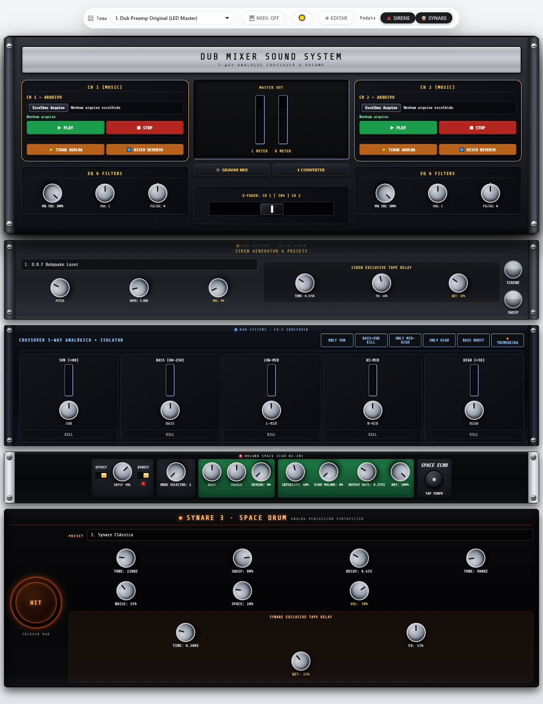
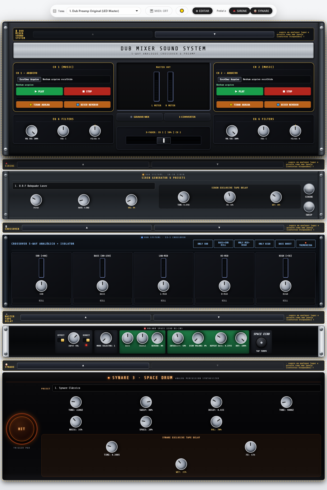
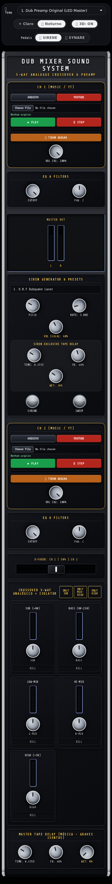
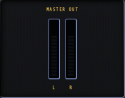
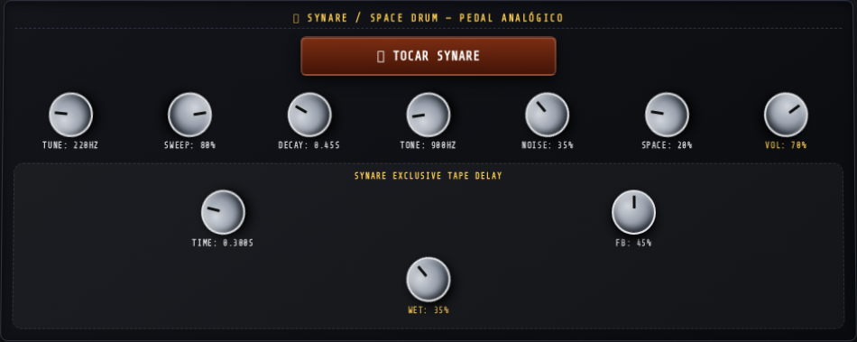
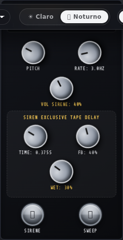
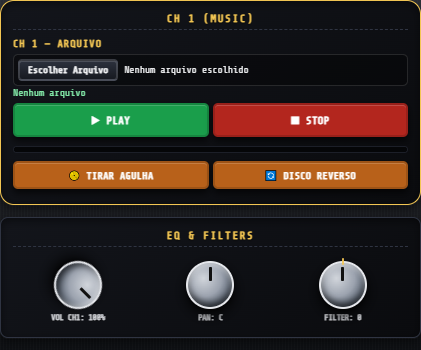
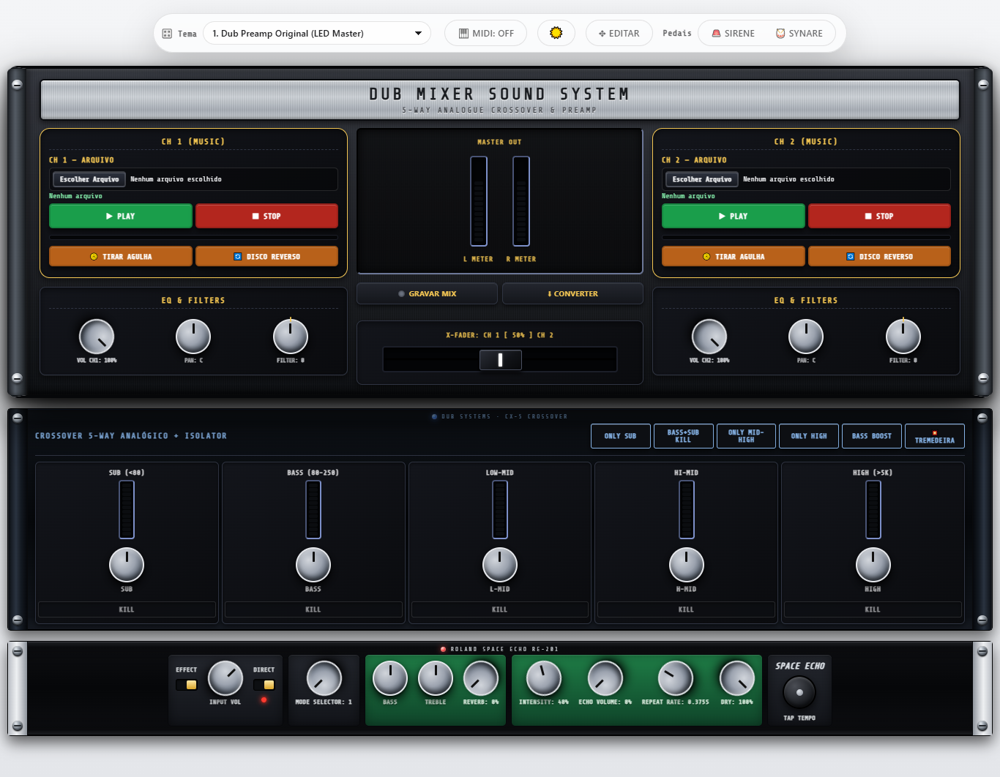
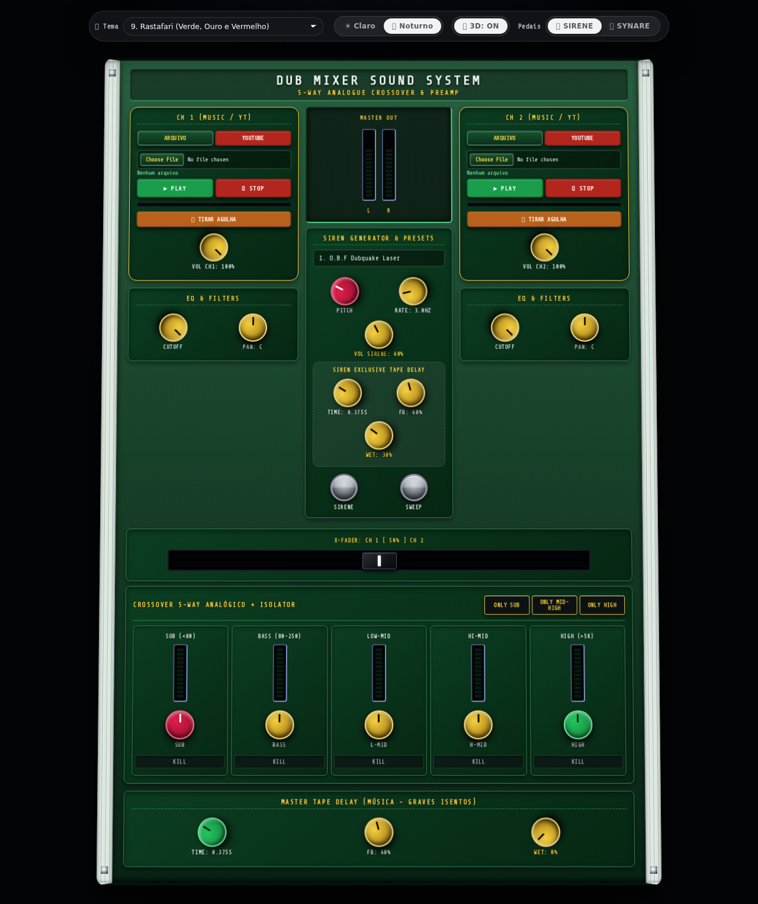
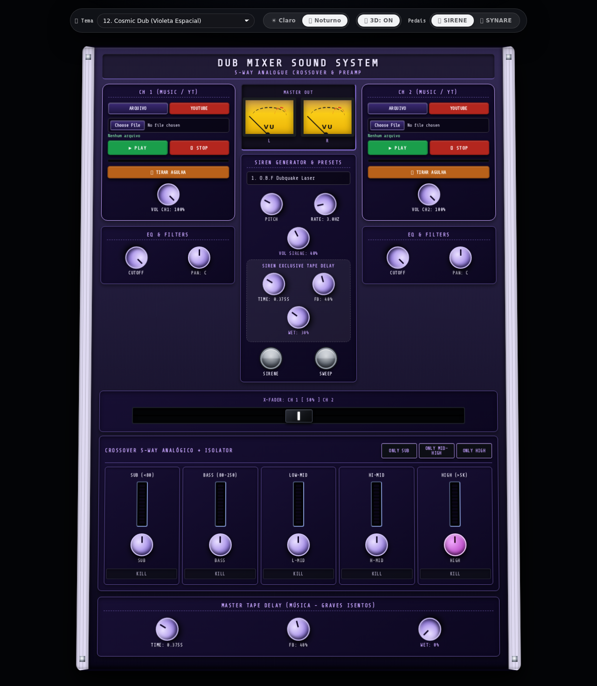

# 🎛️ DUB MIXER SOUND SYSTEM

**Uma mesa de som dub completa, dentro de um único arquivo HTML.**

Preamp de 2 canais + crossover analógico de 5 vias + delay de fita + gerador de sirene
+ pedal Synare/Space Drum — tudo rodando no navegador, sem instalar nada, sem conta,
sem internet. A mesa toca apenas os seus arquivos locais.

[](LICENSE)
[](index.html)
[](#-detalhes-técnicos)
[](https://developer.mozilla.org/pt-BR/docs/Web/API/Web_Audio_API)



---

## 📖 Índice

- [Por que usar este app](#-por-que-usar-este-app)
- [Como rodar (Windows / Linux / macOS / celular)](#-como-rodar)
- [Funções — o que a mesa faz](#-funções--o-que-a-mesa-faz)
- [Referência completa dos 32 knobs](#-referência-completa-dos-32-knobs)
- [Pedais opcionais (mostrar / ocultar)](#-pedais-opcionais-mostrar--ocultar)
- [Temas visuais](#-temas-visuais)
- [Compatibilidade testada](#-compatibilidade-testada)
- [Estrutura do projeto](#-estrutura-do-projeto)
- [Detalhes técnicos](#-detalhes-técnicos)
- [Próximos passos](#-próximos-passos)
- [Melhorias planejadas](#-melhorias-planejadas)
- [Perguntas frequentes](#-perguntas-frequentes)
- [Licença e créditos](#-licença-e-créditos)

---

## 🎯 Por que usar este app

Se você faz **dub, steppers, roots, sound system, dub techno ou reggae** — ou só gosta
de brincar de dub em casa — você já topou com este problema:

> pra ter um som de dub de verdade você precisa de uma mesa, um crossover, um delay
> de fita e uma sirene. Isso é equipamento caro, pesado e que ocupa a sala inteira.

Este app resolve isso com **um arquivo HTML**:

| O problema do equipamento real | O que este app faz |
|---|---|
| Mesa + crossover custam milhares de reais | Roda de graça, em qualquer navegador |
| Você precisa montar, ligar cabo, ajustar ganho | Abre o arquivo, aperta PLAY |
| Delay de fita é caro e precisa de manutenção | Delay digital com FB/TIME/WET, 3 delays independentes |
| Sirene de sound system custa uma fortuna | 10 presets de sirene prontos (O.B.F, Iration, King Tubby…) |
| Não dá pra levar pro ensaio / viagem | Abre no celular também |
| Produtor precisa exportar pra DAW | Você toca ao vivo e grava a saída de áudio do sistema |

**E o mais importante:** você vê a mesa exatamente como ela é. Madeira, parafusos,
LEDs, knobs que giram de verdade com o mouse (ou com o dedo), fader com curso real.
Não é um formulário com sliders — é um gabinete.

### Pra quem é

- **Sound system / selectah** que quer ensaiar dub em casa ou levar pronto numa festa.
- **Produtor** que quer testar um kill de SUB ou um delay antes de montar na DAW.
- **DJ de reggae/dub** que quer fazer um drop ao vivo.
- **Curioso / estudante** que quer ver como funciona um crossover de 5 vias de verdade.
- **Dev / maker** que quer um exemplo real de Web Audio API em um único arquivo.

### O que ele NÃO é

- Não é uma DAW. Não grava nem exporta áudio (você pode rotear a saída do sistema).
- Não substitui uma mesa física se você precisa de pré-amp de microfone,
  phono real ou XLR. (Mas veja o [roadmap de hardware](#-próximos-passos) — R$100.)
- Não hospeda música. Ele toca **seus** arquivos (MP3, WAV, OGG, M4A).

---

## 🗺️ Roadmaps (próximas frentes)

O projeto tem **duas frentes futuras** documentadas:

- **[Versão física (hardware, R$ 100)](docs/ROADMAP-HARDWARE.md)** — mesa de dub de
  verdade que liga na tomada: crossover analógico, delay PT2399, sirene VCO, Synare
  LM13700, tudo em chassi de madeira. **Os 32 knobs desta tela são a especificação.**
- **Versão executável (app nativo)** — em desenvolvimento (Rust/Tauri, com DSP em
  `rust/` e `dsp/`). Roda em Linux/macOS/Windows com a mesma interface.

> Leia os roadmaps antes de comprar qualquer componente: o hardware começa por
> "um canal de ponta a ponta" para não comprar tudo e não montar nada.

## 🚀 Como rodar

### Windows (jeito fácil)

1. Baixe o repositório (botão verde **Code → Download ZIP**) e descompacte.
2. **Abra o `index.html` com duplo clique** — funciona direto (os launchers opcionais usam `dub-mixer.sh` se tiver Git Bash/WSL).
3. Se quiser servir localmente (ex.: para o celular na mesma Wi-Fi):
   ```
   python -m http.server 8712
   ```
   e abra **http://127.0.0.1:8712/index.html**.

Precisa do **Python** instalado ([python.org](https://www.python.org/downloads/))
apenas se for servir localmente (opcional).

> Se a tela estiver estranha, um `Ctrl+Shift+R` resolve (limpa o cache).
> A mesa toca apenas **arquivos locais**.

### Linux

```bash
git clone https://github.com/hroderik/dub-sound-system-studio.git
cd dub-sound-system-studio
./dub-mixer.sh
```

O script detecta `python3`, sobe o servidor na porta `8712`, espera responder e abre o
navegador (`xdg-open`, Firefox, Chrome, Chromium…). Ao fechar a janela, o servidor
encerra sozinho.

### macOS

- **Duplo clique** em `Dub Mixer.command` (pode pedir para liberar em
  *Ajustes → Privacidade e Segurança* na primeira vez), **ou**
- pelo terminal: `./dub-mixer.sh`

### Celular / tablet

O mixer é responsivo e **funciona por toque** (knobs arrastam com o dedo). Duas formas:

1. **Pelo PC na mesma Wi-Fi** — rode o `dub-mixer.sh` (ele já imprime o endereço):
   ```
   http://192.168.x.x:8712/index.html
   ```
2. **Pelo GitHub Pages** (não precisa de PC ligado):
   👉 **https://hroderik.github.io/dub-sound-system-studio/**





### Ou... só abrir o arquivo

Clique duas vezes em `index.html`. **Tudo funciona**, inclusive offline.

---

## 🎛️ Funções — o que a mesa faz

### ✨ Novidades recentes

- **BASS BOOST** — botão on/off, o último da fileira (5º lugar); reforço de +12 dB abaixo de 110 Hz
  (low-shelf real no master).
- **GRAVAR MIX** — captura a saída do master em tempo real (`.webm`/`.ogg`/`.m4a`).
- **CONVERTER** — renderiza a música offline e exporta WAV 16-bit/44,1 kHz/estéreo com
  todos os seus ajustes.
- **X-FADER na torre central**, logo abaixo do MASTER OUT.
- **VOL movido para dentro do EQ & FILTERS** (ordem VOL → PAN → FILTER bipolar) nos dois canais.
- **Toolbar auto-hide** — rola pra baixo e ela some; volta ao rolar pra cima ou com o
  mouse no topo.
- **3D desativado por padrão** (botão 📐 3D: OFF).
- **MODO EDIÇÃO** — botão ✥ EDITAR na toolbar: **segure o equipamento e arraste pra
  cima ou pra baixo** (mouse ou dedo) pra mudar a ordem — vale para os módulos
  externos (SIRENE, CROSSOVER, SYNARE) **e para o próprio DUB MIXER SOUND SYSTEM**.
  No modo edição os **knobs, botões e faders continuam funcionando normalmente**;
  para arrastar, segure numa parte livre do painel (fora dos controles). As setas
  ▲▼ continuam como alternativa. A ordem fica salva e volta quando abrir de novo.
- **Tudo com cara de rack 19"** — o gabinete principal tem orelhas metálicas com
  parafusos e fica na mesma largura dos módulos externos (SIREN e CROSSOVER, com
  orelhas e parafusos); o CROSSOVER é um modelo diferente (anodizado preto/azul).
- **SYNARE externo** com visual de Space Drum (corpo escuro + pad circular de trigger).
- **MASTER TAPE DELAY embutido na caixa do CROSSOVER** (uma caixa só, sem vão).
- **Volume da sirene em 40 %** por padrão.
- **VU estéreo real** (L/R) — mostradores retangulares laranja com moldura preta, sobre placa de alumínio com parafusos ("L METER" / "R METER" / "ANALOG VU METER"); a luz interna brilha junto com o SUB + BASS (e apaga quando os graves levam KILL).
- **DRY no delay** — knob DRY no MASTER TAPE DELAY: mistura o sinal seco junto do eco (100 % por padrão).
- **FILTER bipolar por canal** — um só knob no lugar de LOWPASS + HIGHPASS: centro = 0 (filtros abertos); girando para a ESQUERDA fecha o LOWPASS (100 Hz – 20 kHz) e para a DIREITA sobe o HIGHPASS (20 Hz – 20 kHz). Duplo clique volta ao centro.
- **PWA** — manifest + service worker: instalável na tela inicial e funciona offline.
- **Reverb de mola** — knob REVERB no master (depois do delay), com impulso de spring.
- **MIDI** — botão 🎹 MIDI: ON/OFF com soft takeover (CCs mapeados para os knobs).

### 🎚️ Canal 1 e Canal 2 (decks)

Cada canal aceita **arquivos locais** (MP3/WAV/OGG/M4A — o que o navegador suportar).

Controles por canal:

| Controle | O que faz |
|---|---|
| **▶ PLAY / ⏸ STOP** | Toca/pausa o arquivo local |
| **📀 TIRAR AGULHA** | Para o deck com o estalo da agulha saindo do disco |
| **🔄 DISCO REVERSO** | Backspin liga/desliga em **1,2x** com o **som do disco arranhando** junto: Aperta e a música fica voltando até você apertar de novo (ou TIRAR AGULHA / STOP) — aí a música volta de onde a agulha parou |
| **VOL CH1 / VOL CH2** | Volume do canal (knob) |
| **FILTER bipolar** | Um só knob: centro = 0 (tudo aberto); esquerda fecha o LOWPASS (100 Hz – 20 kHz), direita sobe o HIGHPASS (20 Hz – 20 kHz) |
| **LED + VU** | Nível do canal, acende com o som |
| **Barra de progresso** | Posição da faixa |

> Os arquivos locais passam **todos** pelos filtros, crossover e delays.

### 🔀 Crossover de 5 vias + kills + only

O coração do som dub: a música é dividida em **5 bandas** por filtros reais, e cada
banda tem seu próprio fader e seu próprio kill.

| Banda | Faixa de frequência | Filtros |
|---|---|---|
| **SUB** | abaixo de 80 Hz | lowpass 80 Hz |
| **BASS** | 80 – 250 Hz | highpass 80 + lowpass 250 |
| **L-MID** | 250 Hz – 1,2 kHz | highpass 250 + lowpass 1200 |
| **H-MID** | 1,2 kHz – 5 kHz | highpass 1200 + lowpass 5000 |
| **HIGH** | acima de 5 kHz | highpass 5000 |

Para cada banda você tem:

- **Knob de volume (0–200%)** — SUB, BASS, L-MID, H-MID, HIGH
  (100% = neutro, abaixo disso corta, acima dá reforço).
- **Botão KILL** — corta a banda na hora (o clássico *drop* de dub: mata o baixo,
  deixa a caixa ecoando, e devolve tudo de uma vez).
- **LED** por banda, mostrando o nível em tempo real.
- **Botões de banda** — na ordem da fileira: ONLY SUB, BASS+SUB KILL, ONLY MID-HIGH, ONLY HIGH, BASS BOOST:
  - **ONLY SUB** — só o grave.
  - **BASS+SUB KILL** — mata (ou solta) BASS e SUB juntos.
  - **ONLY MID-HIGH** — tira o sub e o bass.
  - **ONLY HIGH** — só o agudo.

### ↔️ X-FADER

Fader cruzado entre os canais, com curso real e porcentagem lida no visor
(`X-FADER: CH 1 [ 82% ] CH 2`). Clique em qualquer ponto da pista ou arraste a
capa com o mouse **ou com o dedo** (funciona nos dois navegadores).
**Clique duplo volta para o centro (50/50)**.

### 🔊 MASTER OUT — VU estéreo

O master tem **dois VU meters**, um por lado (**L** e **R**) — o som que sai de verdade,
não uma estimativa. Cada lado tem:

- **Torre de 12 LEDs** (verde → âmbar → vermelho) — acende com o som.
- **VU analógico de ponteiro** — o medidor com agulha que acompanha o ritmo.

Por dentro: o som sai do `masterGain` direto para o `AudioContext.destination`, e o
**mesmo sinal** passa em paralelo por um `ChannelSplitter` de 2 vias para os dois
`AnalyserNode` (L e R). Por isso, ao jogar o **PAN** de um canal para o lado, você vê
os dois VUs se desequilibrarem.



### 📼 Master Tape Delay

Delay **da música** (depois do crossover e antes do master), com 3 knobs:

- **TIME** — 0,05 s a 1,20 s
- **FB** — realimentação 0–90 %
- **WET** — quanto do delay entra no master (0 % por padrão, ligue conforme o gosto)
- **DRY** — quanto do sinal original continua junto do eco (100 % por padrão)

Tem um filtro passa-baixa no caminho do delay, pra ficar aquele eco escuro de fita
em vez de eco digital brilhante. E um **VU próprio**, mostrando que o delay está vivo.

### 🚨 SIREN GENERATOR & PRESETS

Gerador de sirene de sound system, com **10 presets** já calibrados:

| # | Preset | # | Preset |
|---|---|---|---|
| 1 | O.B.F Dubquake Laser | 6 | Mungo's Hi Fi Rub-A-Dub |
| 2 | Kebra Ethiopia Stepper | 7 | Alpha & Omega Cyber Beam |
| 3 | Iration Steppas Year 3000 | 8 | Stand High Patrol Sweeper |
| 4 | King Tubby Sub Siren | 9 | Channel One Roots Sine |
| 5 | Jah Shaka Warrior Horn | 10 | Aba Shanti-I Meditation |

Controles: **PITCH** (50–1500 Hz), **RATE** (0,01–25 Hz), **VOL SIRENE**,
e um **🚨 delay exclusivo só da sirene** (TIME / FB / WET).

Dois **push buttons redondos metálicos** ficam embaixo dos controles, com o rótulo
**embaixo do botão**. O botão em si é **liso, sem nada escrito dentro** — de propósito:
no meio do set o dedo não cobre o nome, e a cor já diz tudo. Ambos são **on/off com
um clique**:

| Botão | O que faz |
|---|---|
| **SIRENE** | Dispara a sirene. Clique de novo e ela para |
| **SWEEP** | Abaixa o **RATE** gradualmente (a sirene vai desacelerando até o mínimo). Clique de novo e o RATE volta ao valor anterior |

Os dois são **cinza quando desligados e vermelhos quando ligados** (com um brilho
vermelho no aro), igual equipamento de verdade — no modo 3D dá para ver a cor
mudar de longe, sem precisar ler nada.

### 🥁 SYNARE / SPACE DRUM — pedal analógico

O tambor sintético que virou assinatura do dub digital. Um oscilador com varredura
de tom + ruído + filtro ressonante, disparado por um botão.

- **TUNE** — 40–1000 Hz (tom base)
- **SWEEP** — 0–100 % (quanto o tom varre ao ser tocado)
- **DECAY** — 0,05–1,5 s (duração do tambor)
- **TONE** — 100–6000 Hz (filtro ressonante, Q alto)
- **NOISE** — 0–100 % (mistura de ruído do ataque)
- **SPACE** — 0–100 % (LFO de 6,5 Hz = o "space drum" que pulsa)
- **VOL** — volume do pedal
- **Exclusive Tape Delay:** **TIME / FB / WET** — delay **só do Synare**,
  independente do delay da música e do delay da sirene.



Botão **🥁 TOCAR SYNARE** — toque quantas vezes quiser, cada toque é uma voz nova
que se desconecta sozinha (sem vazamento de áudio).



### 🧰 Barra de ferramentas (topo)

| Grupo | O que faz |
|---|---|
| **🎛️ Tema** | 12 visuais de equipamento (veja [Temas](#-temas-visuais)) |
| **☀️ Claro / 🌙 Noturno** | Fundo da página |
| **🎛️ Pedais** | Mostra/oculta a SIRENE e o SYNARE |


---

## 🎚️ Referência completa dos 32 knobs

Todos os knobs: **arraste para cima/baixo** com o mouse ou **com o dedo**.
**Duplo clique** volta ao valor de fábrica. O valor aparece ao lado do nome.

### Deck 1 e Deck 2

| Knob | Rótulo | Faixa | Padrão |
|---|---|---|---|
| `knobVolA` | VOL CH1 | 0–100 % | 100 % |
| `knobSweepA` | FILTER (CH1) | LP 100 Hz – 20 kHz ◄ 0 ► HP 20 Hz – 20 kHz | 0 (centro) |
| `knobPanA` | PAN (CH1) | L 100 – C – R 100 | C (centro) |
| `knobVolB` | VOL CH2 | 0–100 % | 100 % |
| `knobSweepB` | FILTER (CH2) | LP 100 Hz – 20 kHz ◄ 0 ► HP 20 Hz – 20 kHz | 0 (centro) |
| `knobPanB` | PAN (CH2) | L 100 – C – R 100 | C (centro) |

> O **PAN** fica ao lado do **FILTER** em cada canal. Ele é um `StereoPannerNode`
> criado a cada play.



### Crossover — ganho por banda

| Knob | Rótulo | Faixa | Padrão |
|---|---|---|---|
| `knobIsoSub` | SUB | 0–200 % | 100 % |
| `knobIsoBass` | BASS | 0–200 % | 100 % |
| `knobIsoLM` | L-MID | 0–200 % | 100 % |
| `knobIsoHM` | H-MID | 0–200 % | 100 % |
| `knobIsoHigh` | HIGH | 0–200 % | 100 % |

### Master Tape Delay

| Knob | Rótulo | Faixa | Padrão |
|---|---|---|---|
| `knobMasterDTime` | TIME | 0,05 – 1,20 s | 0,375 s |
| `knobMasterDFB` | FB | 0–90 % | 40 % |
| `knobMasterDWet` | WET | 0–100 % | 0 % (desligado) |
| `knobMasterDDry` | DRY | 0–100 % | 100 % (sinal seco) |

### Siren Generator

| Knob | Rótulo | Faixa | Padrão |
|---|---|---|---|
| `knobSirenPitch` | PITCH | 50 – 1500 Hz | 440 Hz |
| `knobSirenRate` | RATE | 0,01 – 25 Hz | 3,0 Hz |
| `knobSirenVol` | VOL SIRENE | 0–100 % | 40 % |
| `knobSirenDTime` | TIME (delay) | 0,05 – 1,20 s | 0,375 s |
| `knobSirenDFB` | FB (delay) | 0–90 % | 40 % |
| `knobSirenDWet` | WET (delay) | 0–100 % | 30 % |

### Synare / Space Drum

| Knob | Rótulo | Faixa | Padrão |
|---|---|---|---|
| `knobSynTune` | TUNE | 40 – 1000 Hz | 220 Hz |
| `knobSynSweep` | SWEEP | 0–100 % | 80 % |
| `knobSynDecay` | DECAY | 0,05 – 1,50 s | 0,45 s |
| `knobSynTone` | TONE | 100 – 6000 Hz | 900 Hz |
| `knobSynNoise` | NOISE | 0–100 % | 35 % |
| `knobSynSpace` | SPACE | 0–100 % | 20 % |
| `knobSynVol` | VOL | 0–100 % | 18 % |
| `knobSynDTime` | TIME (delay) | 0,05 – 1,20 s | 0,300 s |
| `knobSynDFB` | FB (delay) | 0–90 % | 45 % |
| `knobSynDWet` | WET (delay) | 0–100 % | 35 % |

> **Três delays independentes**: um da música (master), um da sirene e um do Synare.
> Você pode mandar um eco gigante no tambor sem sujar a música.

---

## 🎛️ Pedais opcionais (mostrar / ocultar)

Nem todo mundo usa tudo. Na barra **🎛️ Pedais** você liga e desliga:

- **🚨 SIRENE** — o bloco *SIREN GENERATOR & PRESETS*
- **🥁 SYNARE** — o pedal completo

> **O SYNARE já vem oculto** quando o app abre. É um pedal de uso pontual (você
> dispara e pronto), então a mesa abre mais enxuta — e um clique em **🥁 SYNARE**
> traz o pedal de volta. Se preferir que ele apareça sempre, é só deixar o botão
> ligado: o app lembra do estado enquanto a página está aberta.

Quando você oculta, acontecem três coisas:

1. O equipamento **sai de cima da mesa**.
2. A mesa entra em **modo compacto**: fica ~**686 px mais curta** e ~**86 px mais estreita**.
3. Segurança: se a sirene estiver **soando** e você ocultar o pedal, ela **para sozinha**
   (nunca fica um som fantasma sem controle na tela).

| Estado | Altura do gabinete |
|---|---|
| Tudo visível | 1815 px |
| **Só o Synare oculto** (como o app **abre**) | **1394 px** |
| Só a sirene oculta | 1508 px |
| Os dois ocultos | 1129 px |



---

## 🎨 Temas visuais

Doze visuais de equipamento, trocados na barra de ferramentas. O tema muda o material
do painel, a cor dos knobs, os LEDs e o texto — mantendo o mesmo layout.

| # | Tema | Visual |
|---|---|---|
| 1 | **Dub Preamp Original** | Preto com madeira e LED master (padrão) |
| 2 | **Mustard Synth** | Painel amarelo mostarda |
| 3 | **Benidub Style** | Preto/branco com knobs prata |
| 4 | **DIY Box** | Alumínio com knobs coloridos |
| 5 | **Golden Acapulco** | Psicodélico rosa/amarelo |
| 6 | **DJ Mixer** | Painel escuro de DJ |
| 7 | **Vintage Conservado** | Mesa antiga, madeira envelhecida |
| 8 | **MPC Clássica** | Cinza com vermelho Akai |
| 9 | **Rastafari** | Verde, ouro e vermelho (LED master) |
| 10 | **King Tubby's Water** | Azul água (VU analógico) |
| 11 | **Volcano Lava** | Laranja sobre basalto (LED master) |
| 12 | **Cosmic Dub** | Violeta espacial (VU analógico) |
| 13 | **Neve 1073** | Azul marinho + prata (preamp clássico) |
| 14 | **API 512** | Burgundy + prata (preamp americano) |
| 15 | **SSL 4000** | Grafite + azul (channel strip) |
| 16 | **Tube Preamp** | Valvulado, warm, dourado |

Combine com o fundo **☀️ Claro** ou **🌙 Noturno**.

> Nos temas de **painel claro** (Mustard, DIY, Acapulco, Vintage, MPC) as cores de
> status — verde do arquivo carregado, azul de aviso, âmbar e vermelho de erro — são
> trocadas por tons **escuros**, senão o texto sumiria no fundo claro.




---

## ✅ Compatibilidade testada

Testes automatizados reais (Playwright) rodando o app de verdade:

| Navegador / dispositivo | Viewports testados | Resultado |
|---|---|---|
| **Firefox** (desktop) | 1440, 1280, 1024, 960, 900, 768, 600, 520, 420, 380, 320 px | ✅ 88 combinações, **zero** problemas de layout |
| **Chromium / Chrome** | 1280 px | ✅ |
| **iPhone (390×844)** retrato | toque | ✅ sem rolagem lateral |
| **Celular (844×390)** paisagem | toque | ✅ |
| **Android (360×740)** | toque | ✅ |

O que é verificado em cada rodada:

- **Rolagem lateral = 0 px** em todas as larguras (nada de "arrastar pra ver o resto").
- **Alinhamento da torre central**: desvio máximo de **0,01 px**.
- **Visual realista preservado**: orelhas metálicas 26 px, borda superior 4 px, knob com borda 2 px,
  fader 58 px, fonte *Share Tech Mono*, transformação 3D presente.
- **Arraste de knob por mouse e por toque** funciona (inclusive em Chrome, e depois da
  página ser rolada).
- **Show/hide de pedais** funciona por toque e por clique.
- **Áudio real**: impacto do Synare, cauda do delay a ~1,3 s, kills e onlys mudando o
  espectro, sirene acesa/apagada.
- **Zero erros de JavaScript.**

---

## 📁 Estrutura do projeto

```
dub-sound-system-studio/
│
├── index.html                         ← O APP INTEIRO (um arquivo só, ~160 KB)
│
├── manifest.json + sw.js              ← PWA (instalável, offline)
├── shots.mjs                         ← helper de screenshots (dev)
│
├── frontend/                         ← assets web para o Tauri (index.html, sw.js, dsp/)
├── dsp/                              ← kernels DSP (C + AudioWorklet JS)
│   ├── tape_delay.c
│   └── tape_delay_processor.js
│
├── rust/                             ← versão executável nativa (Tauri 2)
│   ├── Cargo.toml, tauri.conf.json, build.rs
│   └── src/ (main.rs, dsp.rs)
│
├── dub-mixer.sh                       ← Launcher Linux / macOS
├── Dub Mixer.command                  ← Launcher macOS (duplo clique no Finder)
│
├── README.md                          ← este arquivo
├── LICENSE                            ← MIT
│
└── docs/
    ├── ROADMAP-HARDWARE.md            ← plano da versão física (PCB, R$100)
    └── img/                           ← capturas de tela
```

**A versão web não tem build nem dependência** — baixou o `index.html`, abriu,
funcionou. A versão executável (`rust/`) usa Rust/Tauri e requer `cargo tauri build`
(veja o README dentro de `rust/`).

---

## 🔧 Detalhes técnicos

### Um arquivo, zero dependências

Todo o app vive em `index.html`: HTML + CSS + JavaScript. A única coisa externa é a
fonte **Share Tech Mono** (Google Fonts, cai para monoespaçada do sistema se estiver offline).

### O grafo de áudio (Web Audio API)

```
Deck A (arquivo) ─► Gain ─► Lowpass ─┐
                                      ├─► mixerSum ─┬─► LP 80 ──► gSub  ─► analSub  ─┐
Deck B (arquivo) ─► Gain ─► Lowpass ─┘             ├─► HP80+LP250 ─► gBass ─► analBass ─┤
                                                    ├─► HP250+LP1200 ► gLM  ─► analLM  ─┤
                                                    ├─► HP1200+LP5000 ► gHM ─► analHM  ─┤
                                                    └─► HP5000 ──► gHigh ─► analHigh ──┤
                                              (mesmo ponto) ──► Master Tape Delay ────┤
                                                                                       ▼
                                                                                  masterGain ─► saída
Sirene ──► delay da sirene ──┐
Synare ──► delay do Synare ──┴───────────────────────────────────────────────────────► masterGain
```

Cada banda tem um **AnalyserNode** próprio (`fftSize: 64`) alimentando seu VU.

### Os três delays

Cada delay é um trio `DelayNode` + `GainNode` (feedback) + `GainNode` (wet), montado
**uma única vez** dentro de `unlockAudioContext()`. Os knobs só mudam parâmetros —
nunca recriam nós. Isso evita zumbido, clique e vazamento de memória.

### As vozes (sirene e Synare)

São **one-shot**: cada disparo cria oscilador + envelope, conecta no master e no delay,
e **se desconecta sozinho** quando o envelope termina (`onended`). Você pode martelar
o botão do Synare que não acumula.

### O problema do disco (`file://`)

`window.location.protocol === 'file:'` → o app mostra a faixa amarela de aviso
automaticamente e explica o que fazer. É o único jeito honesto de tratar isso.

### Quatro correções que valem registro

**1. O "gabinete 3D" quebrava o clique no Chrome.**
O gabinete usa `perspective` + `transform: rotateX()` + `transform-style: preserve-3d`.
No Chrome, **depois de rolar a página**, o teste de acerto (hit-test) do navegador
devolvia o *container* do knob em vez do knob — o clique "se perdia" em **todos** os
knobs (no Firefox funcionava). A correção foi escutar o `pointerdown` no
`.knob-container` (que **não** tem transformação): o evento borbulha do knob quando o
navegador acerta o knob, e é capturado pelo container quando o navegador erra. Uma
correção, dois navegadores.

**2. Nada de `transform`/`filter` em botões dentro do `preserve-3d`.**
Efeitos de hover/active com `transform` ou `filter` em elementos dentro do gabinete 3D
faziam o Firefox desenhar "bordas invisíveis" em volta de cada elemento e quebravam o
`mousedown`/`mouseup`. Agora o feedback de clique é feito com `box-shadow` e cor.

**3. O X-FADER só funcionava no Firefox.**
O mesmo problema do item 1, um nível abaixo: o arraste era escutado no **cap** (a
peça que corre na pista), e no Chrome o `pointerdown` era entregue à **pista**. O
resultado era silencioso e cruel — o **clique** na pista funcionava (então parecia
tudo bem), mas **arrastar a capa não fazia nada**. Agora o arraste é escutado na
pista e o clique duplo (que volta ao centro) também: um só lugar, os dois
navegadores.

**4. O arraste do X-FADER criava uma seleção de texto.**
Ao arrastar o fader, o navegador começava a selecionar o texto do rótulo acima
(`X-FADER: CH 1 [ 82% ] CH 2`). Dentro do gabinete 3D essa faixa de seleção era
projetada e aparecia como uma **borda fantasma**. A seção do X-FADER agora tem
`user-select: none`, e o `border-style: inset` da pista virou `solid`: o "inset"
faz o navegador desenhar um bisel claro/escuro que, rasterizado dentro do 3D, vira
uma linha de borda visível.

### Acessibilidade

- Botões com `aria-label`, `aria-pressed` e `title` descritivos.
- `role="group"` nos grupos de botões segmentados.
- `button:focus:not(:focus-visible) { outline: none }` — sem anel de foco no clique de
  mouse, mas mantido para navegação por teclado.

---

## 🗺️ Próximos passos

O roadmap tem **duas frentes**. Cada uma tem seu documento:

### 2. Versão física — a mesa de verdade, por R$100

**→ [`docs/ROADMAP-HARDWARE.md`](docs/ROADMAP-HARDWARE.md)**

Um gabinete de madeira (ou impressão 3D) com **PCB próprio**, componentes soldados,
Arduino e os mesmos controles desta tela — **custo-alvo R$100** no patamar mais
simples (mono, reaproveitando sucata; o doc detalha os **três patamares** de custo).

Resumo do plano: crossover analógico de verdade com filtros Sallen-Key (TL072),
delay via **PT2399** (o chip de delay barato e musical), sirene com **VCO CD4046**,
Synare com **LM13700 + ruído**, kill/only com **CD4066**, tudo em um chassi de
madeira com knobs de verdade. O documento traz o **BOM com preços**, o
esquemático em blocos, o roteiro do **PCB no KiCad** e as **fases** — sendo a
primeira "um canal de ponta a ponta", para não comprar tudo e não montar nada.

> Os **32 knobs desta tela são a especificação do hardware**: cada potenciômetro
> físico tem um controle equivalente aqui, com a mesma faixa de valores.

### Ordem sugerida

1. ✅ **Agora** — app web em arquivo único (esta versão).
2. **Depois** — terminar a documentação e os testes de compatibilidade (Android Safari,
   Safari iOS).
3. **Depois** — versão executável nativa (Rust/Tauri, em `rust/`).
4. **Depois** — protótipo em protoboard da versão física.
5. **Depois** — PCB, chassi e produção do primeiro lote.

---

## 💡 Melhorias planejadas

Ideias já mapeadas, em ordem de utilidade:

### Áudio

- [x] **Gravação da saída** — botão REC gravando o master em `.webm`/`.ogg`/`.m4a`
      (via `MediaStreamDestination`), pra você levar o dub direto pra DAW ou postar.
- [x] **CONVERTER** — renderiza a música offline (WAV 16-bit/44,1 kHz/estéreo) com
      todos os seus ajustes (VOL, PAN, FILTER, crossfader, isolator, kills, onlys,
      master tape delay, BASS BOOST).
- [x] **BASS BOOST** — reforço de +12 dB abaixo de 110 Hz no master (on/off).
- [ ] **Presets da mesa inteira** — salvar/carregar a posição de todos os 32 knobs +
      kills + xfader em um "snapshot" (ex.: "Steppa", "Roots", "Digital").
- [ ] **Botão de pânico / reset geral** — volta tudo ao padrão de uma vez.
- [ ] **Delay com sincronia de tempo** — travar o TIME em BPM (1/4, 1/8 pontuado, etc.).
- [ ] **Filtro ressonante (Q ajustável)** no cutoff dos canais, não só lowpass.
- [ ] **Reverb de mola** depois do delay (o som clássico de dub não é só delay).
- [ ] **MIDI / Gamepad** — usar um controlador MIDI barato para os knobs (com
      *soft takeover*, como no DubStemMix).

### Interface

- [x] **Arrastar com a roda do mouse** sobre o knob — (já funciona por toque e mouse).
- [ ] **Teclado** — setas para ajustar o knob em foco (finamente com Shift).
- [ ] **Modo "palco"** — esconde a barra de ferramentas e deixa só a mesa.
- [ ] **Zoom / escala da mesa** (75 %, 100 %, 125 %) para telas pequenas.
- [ ] **Exportar/importar o tema** para compartilhar com outros usuários.
- [ ] **PWA** — instalar na tela inicial e funcionar offline.

### Mobile

- [ ] **Layout de 2 colunas em tablet** (hoje empilha em 1 coluna abaixo de 768 px).
- [ ] **Botões maiores no toque** (mínimo recomendado de 44×44 px nos alvos principais).
- [ ] **Travar a orientação em paisagem** pelo manifest (mesa é mais larga que alta).

### Robustez

- [ ] **Testes no Safari (macOS e iOS)** — é o único motor não coberto ainda.
- [ ] **Verificar uso de memória** com muitas vozes de Synare simultâneas.

---

## ❓ Perguntas frequentes

**Preciso instalar alguma coisa?**
O app em si não instala nada — é um arquivo HTML. O Python só é necessário para
o launcher `dub-mixer.sh` (opcional). No GitHub Pages nem o Python é necessário.

**Funciona no celular?**
Sim, e com arraste por toque. Use o GitHub Pages ou o endereço na Wi-Fi que o
`dub-mixer.sh` imprime.

**Funciona offline?**
Sim — os arquivos locais, os filtros, delays, sirene e Synare funcionam sem internet.

**Posso usar minhas músicas?**
Sim, o canal 1 e o canal 2 tocam arquivos locais (MP3, WAV, OGG, M4A — o que o
navegador suportar). Elas passam por todos os filtros e delays.

**Por que o botão da sirene não tem texto dentro?**
Por escolha de design: no meio do set você quer acertar o botão sem ler. O botão é um
**círculo metálico liso, sem nada escrito dentro** (nem emoji) e o **rótulo fica embaixo**
dele, como num equipamento de verdade — o dedo não cobre o nome. Vale para o botão da
sirene e para o do sweep. Os dois são **on/off com um clique** e mudam de **cinza para
vermelho** quando ligados.

**Como faço um drop de dub clássico?**
1. Toque a música com o baixo presente.
2. **KILL SUB** (mata o grave) e **KILL BASS**.
3. Aumente o **WET do Master Tape Delay** e mande a sirene (🚨).
4. No momento certo, **solte os kills** e devolva o grave.

**O valor aparece errado / travou.**
Duplo clique no knob volta ao padrão de fábrica. Se a sirene ficar soando, clique no
**push button** de novo ou oculte o pedal **SIRENE** (ela para sozinha).

**Posso usar comercialmente?**
O código é MIT (veja [Licença](#-licença-e-créditos)). Respeite os direitos das músicas
que você tocar.

---

## 📜 Licença e créditos

**MIT** — use, modifique, distribua, faça sua versão. Veja [`LICENSE`](LICENSE).

Créditos e inspirações:

- **[DubStemMix](https://github.com/hroderik/DubStemMix)** — console dub nativo (Swift/C,
  MIT). Referência de arquitetura para a futura versão executável: buses compartilhados
  com handoff de 1 buffer, soft takeover de knobs, perfis de controlador como dados.
- **Presets de sirene** — nomes inspirados nos estilos clássicos de sound system
  (O.B.F, Iration Steppas, King Tubby, Jah Shaka, Channel One, Mungo's Hi Fi,
  Alpha & Omega, Aba Shanti-I, Kebra Ethiopia, Stand High Patrol). São apenas
  homenagens de estilo — nenhuma gravação ou sample de terceiros é usada.
- **[Web Audio API](https://developer.mozilla.org/pt-BR/docs/Web/API/Web_Audio_API)** —
  toda a engine de áudio.
- **Share Tech Mono** — a fonte do painel (Google Fonts, licença SIL OFL).

---

<p align="center">
  <strong>🎛️ Feito para tocar dub. Abra o arquivo e mande o grave.</strong><br>
  <sub>Se este app foi útil, deixe uma ⭐ no repositório — ajuda outras pessoas a achar.</sub>
</p>
